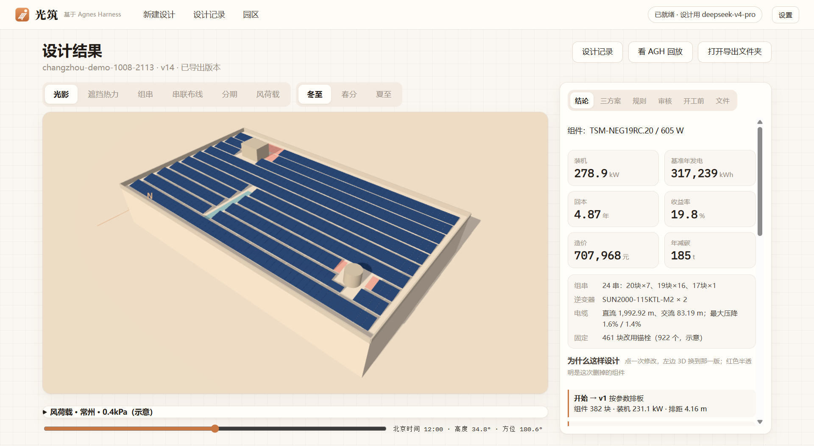
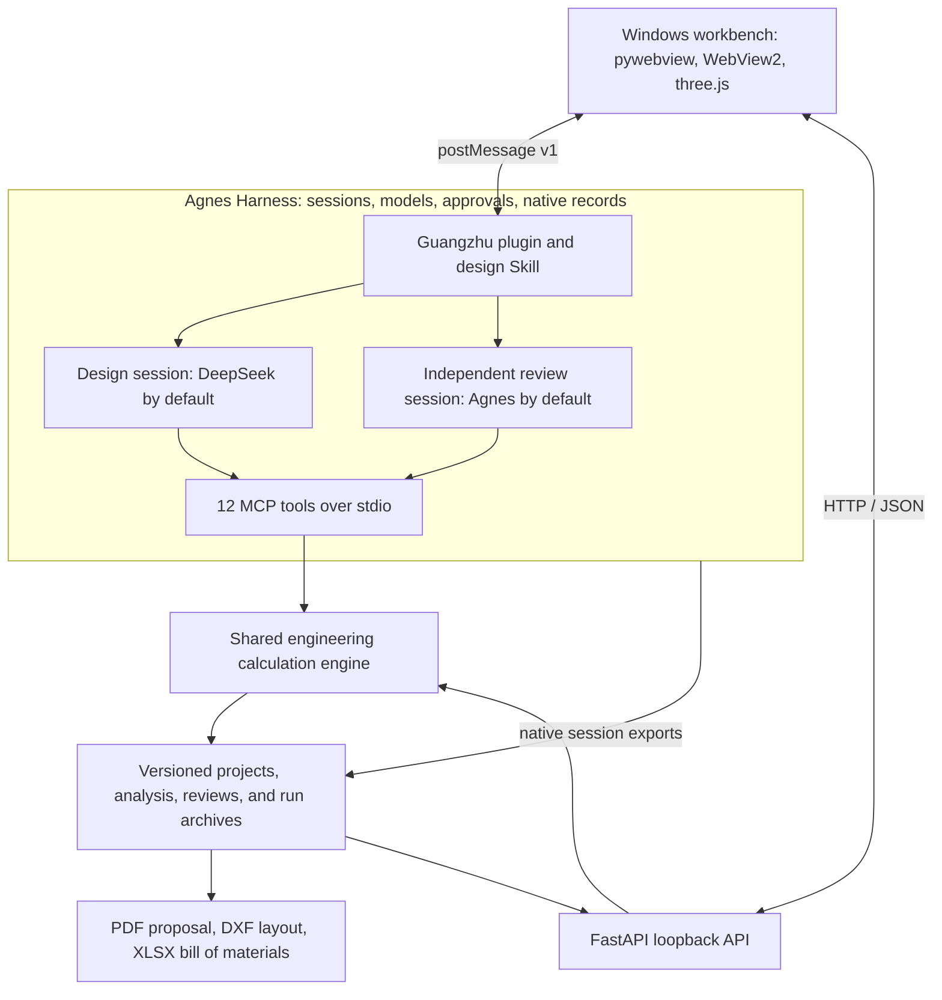

# Guangzhu · Rooftop Solar PV Design Agent

**English** | [简体中文](README.zh-CN.md)

Turn a rooftop and a plain-language brief into a checked solar PV proposal, drawings, and bill of materials.

The November reliability update is version **0.3.0**, available as a local Windows build; it has not been published as a GitHub release. The new key-free flow uses deterministic design rules and command parsing. Users preview a specific version before confirming its export; this flow does not provide independent model review. The existing AGH model workflow remains separate and records its review provenance. See the [repair and installation record](docs/RELIABILITY_VALIDATION_2026-11.md) for test scope and results, and the [three-competition materials](docs/materials/three-competitions-2026/README.md) (Chinese). The four Taizhou examples are synthetic scenarios with stated assumptions, not surveyed sites or customer projects.

The November source update adds compound flat/gable roofs, live 3D modeling, precise object arrays, and previewable partial layout changes that preserve manual locks. See the [upgrade and verification guide](docs/COMPETITION_UPGRADE_2026-11.md) (Chinese). Existing v0.2.0 binaries do not include this source update.

Factory facade controls add wall finishes and colors, columns, plinths, window bands, doors, canopies, and loading docks. See the [facade editing guide](docs/FACTORY_FACADE_2026-11.md) (Chinese).

The precision modeling workbench adds an object list, multi-selection, previewable move/rotate/mirror operations, standard and orthographic views, and segmented parapets shared by rendering and shading calculations. See the [modeling guide and software references](docs/MODELING_WORKBENCH_2026-11.md) (Chinese).

PV modules can now be added, moved, and rotated manually with validated roof geometry, protected regions, shading comparisons, and versioned undo. See the [manual module editing guide](docs/MANUAL_MODULES_2026-11.md) (Chinese).

The 3D workbench now supports dragging and rotation handles with grid, neighbouring-module, and angle snapping. Rule diagnostics locate affected objects and offer explicit repair previews; version evidence records input consistency, calculation-file hashes, reviews, exports, and available session usage. See the [3D editing guide](docs/THREE_DIMENSIONAL_EDITING_2026-11.md) and [verification record](docs/THREE_DIMENSIONAL_EDITING_VALIDATION_2026-11.md) (Chinese).

2026 Jiangsu AI + Science & Engineering Hackathon · Undergraduate division · U058「验形工坊」

[Project Overview](#project-overview) · [Demo Video](#demo-video) · [Architecture](#architecture) · [Integration Standards](#integration-standards) · [Getting Started](#getting-started) · [Verification](#verification)



*An archived Changzhou example, recorded on October 8, 2026: 278.9 kWp with an estimated 4.87-year simple payback. Roof equipment, structural capacity, and some economic inputs are illustrative.*

## Project Overview

Factory owners and PV designers need to answer several connected questions: how much capacity fits, how shading affects generation, whether the electrical and roof-load checks pass, and when the investment might pay back. Changing a walkway, budget, or tilt can require another round of calculations.

Guangzhu brings these steps into a Windows desktop workbench built on [Agnes Harness (AGH)](https://github.com/AgnesAI-Labs/agnes-harness). Select a roof, draw one, or import a drawing, then enter a brief such as “Pay back within six years, keep a one-metre maintenance walkway, and avoid the skylights.” The design agent plans the work, calls engineering tools, revises failed checks, and compares three options. A separate AGH session performs an independent review. The selected design can be exported after the user approves it.

### Core features

| Capability | What it does |
| --- | --- |
| Roof modelling and drawing import | Draw by dimensions or vertices; import images, PDF, and DXF. Supports flat and metal roofs, pitched roof planes, ground sites, carports, and agricultural structures. |
| Layout and shading | South-facing, roof-aligned, and east–west layouts; weather-based tilt selection; per-module shading from equipment, parapets, neighbouring buildings, and trees. |
| Generation and engineering checks | Hourly energy estimates, multiple calculation chains, string and inverter checks, cable routing and voltage drop, wind zones, fixing requirements, and roof-load checks. |
| Owner constraints and option comparison | Apply capacity, budget, payback, walkway, height, transformer, export, and phased-construction requirements; compare maximum-capacity, fastest-payback, and balanced options. |
| Economics and industrial parks | Itemised costs and 25-year cash flows; self-investment, energy management contracts, and roof leasing; multi-building layouts and queued park designs. |
| Review, delivery, and replay | Independent review; 3D results; PDF proposal, DXF layout, and XLSX bill of materials; SHA256 digests and native AGH execution records. |

### What is distinctive

- **Reasoning backed by calculations.** The model selects tools and handles feedback; geometry, energy, electrical, structural, and economic numbers come from the local calculation engine.
- **A complete AGH workflow.** Planning, tool calls, revisions, verification, approvals, and the independent review retain their session records. The desktop and Python backend make no direct model API calls.
- **Revisions with evidence.** Design changes create new versions with parent versions and reasons. Failed checks guide revisions, with up to six revision rounds; infeasible requirements are reported with possible relaxations.
- **Deliverables tied to the selected version.** Review findings, calculations, drawings, and material lists can be traced to the exported design rather than to an unselected comparison candidate.

The project supports preliminary design and discussion. Real installations require site measurements and professional review of structural, electrical, grid-connection, and financial assumptions. See the [project description](docs/project-description.md) and [submission text](docs/materials/submission-form.txt) for additional context in Chinese.

## Demo Video

**[Watch or download the demo video](https://github.com/3531st-lab/guangzhu/releases/download/v0.2.0/guangzhu-demo.mp4)** · [Release page](https://github.com/3531st-lab/guangzhu/releases/tag/v0.2.0)

The video runs for **4 minutes 54.8 seconds**, at **1920 × 1080 / 30 fps**, with Chinese narration and on-screen subtitles. It demonstrates roof input and drawing import, a natural-language brief, AGH planning and tool calls, approval and independent review, 3D shading and wiring views, option comparison, proposal export, infeasible requirements, and industrial-park designs.

This is the Changzhou demonstration video supplied in the team's submission archive. Computation sequences are edited and accelerated; the video length does not measure a complete design run. Roof and economic assumptions are identified as illustrative. An independently archived Changzhou run is available at [`runs/gz-changzhou-demo-1008-2113/`](runs/gz-changzhou-demo-1008-2113/).

Video SHA256:

```text
1a2d9cc953d4a287a622c9065c42b3223e3b307d22d43002f5b05d88b116d114
```

## Architecture



| Module | Implementation and responsibility |
| --- | --- |
| Desktop workbench | [`desktop/`](desktop/): pywebview + WebView2; native HTML/JavaScript and locally bundled three.js r128 render roofs, shading, strings, and cables. The run view embeds the official AGH web interface. |
| AGH integration | [`agh-plugin/guangzhu-studio/`](agh-plugin/guangzhu-studio/) provides brief submission, result cards, approval guidance, progress messages, and a skin. [The design Skill](.agh/skills/pv-rooftop-design/) defines the task procedure. |
| Engineering engine | [`backend/guangzhu/`](backend/guangzhu/): Shapely geometry and layout; NumPy and pvlib shading/solar/energy calculations; NREL PySAM cross-checks; electrical, structural, rule, and economic modules. MCP and HTTP reuse these functions. |
| Interfaces | [`mcp_server.py`](backend/guangzhu/mcp_server.py) exposes tools; [`api.py`](backend/guangzhu/api.py) serves the local workbench API; [`models.py`](backend/guangzhu/models.py) validates project and design records. |
| Storage and evidence | `projects/<id>/` stores project inputs, design versions, analyses, reviews, and exports. `runs/<id>/` stores AGH session captures, native ledgers, verification, and replay data. User projects are local; only selected reviewed examples are public. |
| Reports and data | [`backend/guangzhu/report/`](backend/guangzhu/report/) creates reports and exchange files. [`data/`](data/) holds roof examples, weather snapshots, equipment catalogues, and validation data with recorded sources. |

The workflow is **brief → plan → create project → fetch weather → layout → analyse → revise → compare → verify → user-approved export → independent review → execution-record verification**. The backend then assembles the proposal using the selected export and saved review. Design and review models are configurable through AGH.

## Integration Standards

### Compatibility and setup

The documented integration was validated with AGH commit **`5da40731214976ad8aff982cd5626d3a676fdd88`**. AGH's plugin and management interfaces evolve; the integration instructions refer to that fixed version. See [external dependencies](docs/DEPENDENCIES.md), [local configuration](docs/CONFIGURATION.md), and the [AGH setup guide](docs/AGH_SETUP.md) for the runtime, separate instance directory, MCP registration, plugin installation, Skill, and model configuration.

### MCP tool interface

Start the official MCP Python SDK server with the Python environment installed for this repository:

```powershell
.\.venv\Scripts\python.exe -m guangzhu.mcp_server
```

Transport is **MCP over stdio**, using JSON-RPC. `tools/list` advertises each tool's input JSON Schema and annotations. Inputs are checked with JSON Schema Draft 2020-12; undeclared fields are rejected. Tool definitions and validation are maintained in [`mcp_server.py`](backend/guangzhu/mcp_server.py).

| Tool | Purpose | Access |
| --- | --- | --- |
| `gz_project_summary` | Read project, current design, and exported-version summary | Read / cache |
| `gz_new_project` | Create a project from a roof template | Write |
| `gz_set_requirements` | Save the original brief and structured constraints | Write |
| `gz_fetch_weather` | Fetch or load weather and return quality checks | Read / cache |
| `gz_generate_layout` | Generate a new layout version | Write |
| `gz_analyze` | Calculate engineering, rule, and economic results; support what-if analysis | Read / cache |
| `gz_edit_design` | Revise a design with a recorded reason | Write |
| `gz_compare_options` | Generate and compare three saved design options | Write |
| `gz_crosscheck_yield` | Cross-check generation through five calculation chains | Read / cache |
| `gz_record_review` | Save the independent review verdict and findings | Write |
| `gz_export` | Reanalyse, check hard rules, and export the selected version | Approval required |
| `gz_wait` | Retrieve the result of an existing background job | Read |

“Read / cache” tools advertise `readOnlyHint=true` and may write recalculable analysis or cache files. Mutating tools retain AGH approval handling. **`gz_export` requires the user's “Allow once” approval**; a session-wide approval does not satisfy the project's export-verification rule.

Example `tools/call` parameters, after MCP initialization and with an existing project:

```json
{
  "name": "gz_project_summary",
  "arguments": {"project_id": "changzhou-demo"}
}
```

- The first MCP text content item contains a JSON object. Successful business results use `ok: true`. Errors use `ok: false`, `error_code`, `message_zh`, and `fix_hint`, with MCP `isError=true`; the message fields currently contain Chinese guidance.
- Business summaries are limited to **2,048 UTF-8 bytes**; complete data remains in project files. A completed `gz_wait` reply adds small job/tool identity fields.
- A call that remains unfinished after the server's approximately 40-second wait returns `pending: true`, `job_id`, and the original `tool`. Continue with `gz_wait({"job_id": "..."})` until a final result arrives, matching the job and tool. A pending response is not a completed calculation.
- New project IDs are 1–64 characters, beginning with an ASCII letter or digit and followed by letters, digits, `_`, or `-`. Existing IDs cannot be overwritten by `gz_new_project`.

### Local HTTP and desktop bridge

The source workbench uses **`http://127.0.0.1:8765`** for Guangzhu and **`http://127.0.0.1:4177`** for AGH. Installed builds use ports **8766 / 4178**. These are local desktop interfaces. Keep the backend bound to loopback.

| HTTP endpoint | Purpose |
| --- | --- |
| `GET /api/status` | Application status and AGH connectivity |
| `GET /api/roofs` | Available roof templates |
| `POST /api/brief` | Validate inputs and assemble a design brief |
| `GET /api/projects/{project_id}/result?version={n}` | Read results for a selected design version |
| `GET /api/runs` and `GET /api/runs/{run_id}` | Read saved runs and replay data |
| `GET /openapi.json` | Generated OpenAPI document for the running backend |

The embedded AGH page and desktop exchange versioned `window.postMessage` messages: `v: 1`, `type`, `id`, and, for replies, `re`. The bridge validates the peer window and exact origin. The `gz.hello` / `gz.ready` handshake precedes session commands; `gz.progress` and `gz.approval` carry progress and approval state. See the [desktop bridge](desktop/web/bridge.js) and [plugin bridge](agh-plugin/guangzhu-studio/src/bridge.js) for the implemented contract.

### Data, units, and engineering rules

| Item | Convention |
| --- | --- |
| Project schema | `guangzhu.project/1`; Pydantic models reject extra fields and non-finite numbers. |
| Units | Geometry in metres; capacity in kW / kWp; energy in kWh; money in CNY; roof load in kN/m². Field names identify other units explicitly. |
| Coordinates | Calculation coordinates: x east, y north, z up. The three.js view maps these to x east, y up, z south. |
| Angles and time | Azimuth clockwise from north; tilt from horizontal. Weather timestamps are timezone-aware; NASA data is read as UTC and the workbench displays Beijing time. |
| Versioning | Design changes append `designs/vN.json` with parent and reason. Recalculable analysis is stored under `analysis/vN/`; exports refer to the selected version. |
| Results | `yield_kwh.p50` names a baseline weather-year estimate; it is not a statistical probability-P50 guarantee. Rule applicability and illustrative assumptions remain visible in results. |
| Exchange and traceability | PDF proposal, DXF layout, XLSX bill of materials, SHA256 file digests, and native AGH session exports. Engineering standards, manufacturer limits, data licences, and assumptions are recorded in [sources](docs/sources.md). |

## Getting Started

### Windows installer

1. Download [`guangzhu-setup.exe` from v0.2.0](https://github.com/3531st-lab/guangzhu/releases/tag/v0.2.0) for Windows 10/11 x64, approximately 149 MB. Installation is per-user and includes the AGH runtime, plugin, tools, and an offline self-check. WebView2 is required.
2. Open Guangzhu. The bundled example can be viewed without a model key. To start a new design, configure a supported provider through the homepage or AGH settings; credentials are handled by AGH's official configuration interface.
3. Select or create a roof, enter requirements, and start the design. Use the native AGH approval cards for tool permissions and “Allow once” for export. Inspect the 3D result, option comparison, rules, review, and deliverables.

The v0.2.0 installer is unsigned. Its published SHA256 is:

```text
19e7be68a43b512839a6cffded1c2ba470820f5f778b52935e7bb2e791eef146
```

### Run from source

Use Windows 10/11 x64, Git, and Python 3.12. Node.js / npm is needed for plugin rebuilding and JavaScript tests.

```powershell
git clone https://github.com/3531st-lab/guangzhu.git
cd guangzhu
powershell -NoProfile -ExecutionPolicy Bypass -File scripts/setup.ps1
.\.venv\Scripts\python.exe -m guangzhu.selfcheck
```

The setup script installs locked dependencies and performs a self-check. For a new agent design, copy [the settings template](desktop/settings.example.json) to `desktop/settings.json`, set local paths, complete [AGH setup](docs/AGH_SETUP.md), then run `start.cmd`. [Sample PDF and DXF drawings](https://github.com/3531st-lab/guangzhu/tree/main/samples/sample-drawing) are available for import.

For offline calculations, archived-run verification, viewing saved results without AGH, and installer rebuilding, follow the [reproduction guide](docs/REPRODUCING.md). Rebuilding the installer requires the additional fixed AGH inputs documented in [DEPENDENCIES.md](docs/DEPENDENCIES.md). PySAM's native loader needs an ASCII cache path; the project handles this through its native runtime cache.

## Verification

| Evidence | Recorded result and scope | Inspect or reproduce |
| --- | --- | --- |
| Solar position | Against USNO official responses: maximum altitude difference 0.0043°, azimuth difference 0.0025° across 29 timestamps | [Recorded responses](data/field/sun-official/); `python scripts/check_official_sun.py` |
| Real-plant energy comparison | NREL PVDAQ system 2107, 893 kW, 2022: mean monthly error about 5.1% with measured plane-of-array irradiance and no parameter tuning | [Monthly results](data/field/plant/2107-monthly.csv) and [method](data/field/plant/README.md) |
| Historical agent evaluation | October 3, 2026, DeepSeek Flash: 51/54 feasible runs successful; 18/18 infeasible runs identified; default layout baseline 1/18 | [24 cases](eval/cases.json); `scripts/eval_run.py`, `scripts/eval_score.py` |
| Native execution and independent review | A public Changzhou design archive contains the design, review, approvals, outputs, and verification | [Run archive](runs/gz-changzhou-demo-1008-2113/); [verification commands](docs/REPRODUCING.md) |

Historical scores describe the recorded model, version, inputs, and success criteria. They are not a success-rate claim for the current version. Recomputing 51/54 requires the full historical evaluation archive; the public sample run alone is insufficient.

### Development checks

```powershell
.\.venv\Scripts\python.exe -m pip install -r requirements-dev.txt
.\.venv\Scripts\python.exe -m pytest -q
node --test agh-plugin/guangzhu-studio/test/*.test.js
node --test tests/embed_harness/*.test.mjs
node --test tests/desktop/*.test.mjs
.\.venv\Scripts\python.exe scripts/check_secrets.py
```

Network-marked Python tests are excluded by default. Some historical tests require unpublished development archives and explicitly skip when those files are absent; report passes, skips, and failures separately. Browser tests use the system Microsoft Edge. See [reproduction](docs/REPRODUCING.md) for expected outputs and plugin build checks.

## Licence and Third-party Sources

Team-authored code is licensed under [MIT](LICENSE). AGH is Apache-2.0; its official runtime is redistributed unchanged with its notices. Other libraries, fonts, and datasets retain their own terms in [THIRD_PARTY_NOTICES.md](THIRD_PARTY_NOTICES.md) and [docs/sources.md](docs/sources.md).

Sources include NASA POWER, JRC PVGIS, OpenStreetMap contributors, NREL equipment catalogues and PVDAQ, and USNO. Calculations use pvlib, PySAM, NumPy, pandas, SciPy, Shapely, and related open-source components; the desktop uses pywebview, WebView2, and three.js. See the [open-source checklist](docs/OPEN_SOURCE_CHECKLIST.md) for the published scope and reproduction evidence.

Keep model credentials, AGH instance directories, private drawings, and unreviewed personal projects outside the public repository. Configure credentials only through Guangzhu's homepage or AGH settings.
