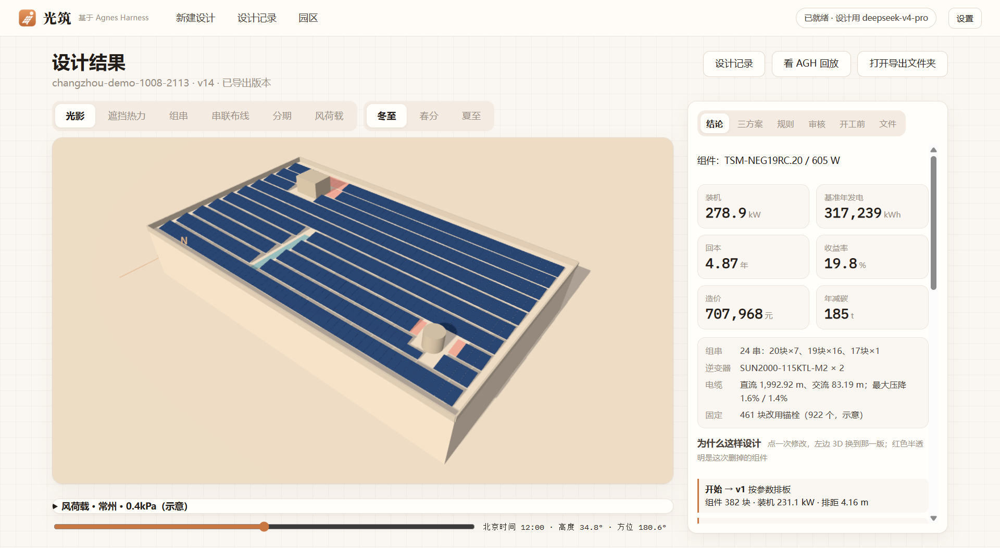
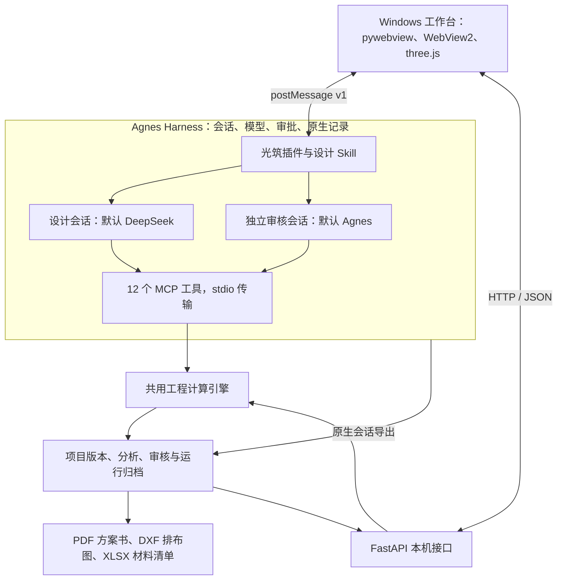

# 光筑 · 工厂屋顶光伏方案自动设计 Agent

[English](README.md) | **简体中文**

从屋顶和一句需求出发，生成经过校核的光伏初步方案、图纸与材料清单。

2026 年 11 月可靠性修复版使用版本号 **0.3.0**，提供本地 Windows 安装包，尚未发布到 GitHub Release。新增免 Key 入口为**规则自动设计与规则指令修改**：预览指定版本后，由用户确认导出；它没有独立模型审核。原有 AGH 模型流程保留，审核与会话来源单独显示。测试范围与结果见[修复及安装验收记录](docs/RELIABILITY_VALIDATION_2026-11.md)，参赛内容见[三赛材料包](docs/materials/three-competitions-2026/README.md)。四类泰州案例均为标明输入假设的合成场景，不代表真实客户或测绘项目。

2026 江苏省高校 AI+科学与工程创新实践黑客松 · 本科生组 · U058「验形工坊」

[项目介绍](#项目介绍) · [视频介绍](#视频介绍) · [架构介绍](#架构介绍) · [集成标准](#集成标准) · [开始使用](#开始使用) · [验证与复现](#验证与复现)



*2026 年 10 月 8 日归档的常州案例：278.9 kWp，预计静态回本 4.87 年。屋面设备、承重和部分经济参数为示意输入。*

## 项目介绍

工厂业主和光伏设计人员需要同时回答几个相互影响的问题：屋顶能装多少，阴影会损失多少发电量，电气和屋面荷载是否满足要求，投资几年回本。调整检修通道、预算或组件倾角后，往往需要重新计算。

光筑是一款基于 [Agnes Harness（AGH）](https://github.com/AgnesAI-Labs/agnes-harness) 的 Windows 桌面工作台。选择屋顶、自行绘制或导入图纸后，输入“6 年内回本，留 1 米检修通道，避开天窗”等需求。设计智能体制定计划、调用工程工具、根据未通过的规则修改方案并比较三种选项；另一个 AGH 会话进行独立审核。选定方案经用户批准后导出。

### 核心功能

2026 年 11 月源码升级已加入平顶／双坡组合厂房、实时三维建模预览、精确尺寸与阵列，以及组件／屋面／区域锁定后的局部重排。修改可预览、确认保存和撤销；[操作与验证说明](docs/COMPETITION_UPGRADE_2026-11.md)。

厂房三维外观支持墙面材质与配色、立柱、勒脚、窗带、门、雨棚和装卸口；[外观编辑说明](docs/FACTORY_FACADE_2026-11.md)。

精确建模工作台增加对象列表与多选、移动／旋转／镜像预览、标准视图与正交投影，以及参与真实遮挡计算的分段女儿墙；[建模操作与同类软件参考](docs/MODELING_WORKBENCH_2026-11.md)。

光伏组件支持手动补放、移动和旋转，联动真实坡面、区域锁定、遮挡比较及版本撤销；[组件手动编辑说明](docs/MANUAL_MODULES_2026-11.md)。

三维工作台现可直接拖动组件、拖动旋转环，并使用网格、邻板和角度吸附；规则面板提供问题定位与修复预览，版本证据卡记录输入一致性、计算文件摘要、审核、导出及已记录会话用量。见[三维操作说明](docs/THREE_DIMENSIONAL_EDITING_2026-11.md)和[验证记录](docs/THREE_DIMENSIONAL_EDITING_VALIDATION_2026-11.md)。公开的 v0.2.0 安装包不含本轮更新；修复后的本地安装包详见当前验收记录。

| 能力 | 实现内容 |
| --- | --- |
| 屋顶建模与图纸导入 | 按尺寸或顶点绘制；导入图片、PDF、DXF。支持混凝土平屋顶、彩钢瓦、斜屋面、空地、车棚及农业设施等安装面。 |
| 排布与阴影 | 正南、顺屋边、东西向人字形排布；按当地天气选择倾角；逐块组件计算设备、女儿墙、周边楼体和树木的遮挡。 |
| 发电与工程校核 | 逐小时发电估算、多计算链复核、组串与逆变器校核、电缆走线及压降、风荷载分区、固定方式和屋面荷载核对。 |
| 业主约束与三方案 | 处理装机、预算、回本、通道、限高、变压器、上网及分期要求；比较多装、最快回本、折中三种方案。 |
| 经济测算与园区 | 分项造价与 25 年现金流；自投、合同能源管理、屋顶租赁；多栋厂房总图与园区排队设计。 |
| 审核、交付与回放 | 独立审核、三维结果、PDF 方案书、DXF 排布图、XLSX 材料清单；SHA256 摘要及 AGH 原生执行记录。 |

### 创新亮点

- **模型决策，工具计算。** 模型负责选择工具、处理反馈；几何、发电、电气、结构与经济数值由本机计算引擎产生。
- **完整的 AGH 工作流程。** 规划、工具调用、修改、验证、审批和独立审核均保留会话记录。桌面端和 Python 后端不直接调用模型 API。
- **修改有版本、有依据。** 每次设计变更生成新版本，记录父版本与原因；依据未通过的规则修正，最多迭代 6 轮。无法满足要求时说明原因并提出可放宽条件。
- **交付与选定版本对应。** 审核意见、计算结果、图纸与材料清单可追溯到批准导出的版本，避免引用未选中的对比候选方案。

作品面向前期方案设计与讨论。实际建设需要现场测量，并由专业人员复核结构、电气、并网与经济假设。更多背景见[作品详情](docs/project-description.md)和[提交表文本](docs/materials/submission-form.txt)。

## 视频介绍

**[观看或下载演示视频](https://github.com/3531st-lab/guangzhu/releases/download/v0.2.0/guangzhu-demo.mp4)** · [Release 页面](https://github.com/3531st-lab/guangzhu/releases/tag/v0.2.0)

视频时长 **4 分 54.8 秒**，**1920 × 1080 / 30 fps**，带中文配音与画面字幕。内容包括屋顶输入与图纸导入、自然语言需求、AGH 规划和工具调用、审批与独立审核、三维阴影和布线、三方案对比、方案书导出、不可行需求及园区设计。

本链接对应团队提交压缩包中的常州演示视频。运算片段经过剪辑与加速，视频长度不代表一次完整设计的实际耗时；屋顶与经济参数按示意口径说明。仓库另提供一次独立归档的常州真实运行：[`runs/gz-changzhou-demo-1008-2113/`](runs/gz-changzhou-demo-1008-2113/)。

视频 SHA256：

```text
1a2d9cc953d4a287a622c9065c42b3223e3b307d22d43002f5b05d88b116d114
```

## 架构介绍



| 模块 | 实现方式与职责 |
| --- | --- |
| 桌面工作台 | [`desktop/`](desktop/)：pywebview + WebView2；原生 HTML/JavaScript 与本地 three.js r128 展示屋顶、阴影、组串和电缆。运行页内嵌 AGH 官方网页。 |
| AGH 集成 | [`agh-plugin/guangzhu-studio/`](agh-plugin/guangzhu-studio/) 提供任务书提交、工具结果卡片、审批提示、进度传话与皮肤。[设计 Skill](.agh/skills/pv-rooftop-design/) 定义任务执行步骤。 |
| 工程计算引擎 | [`backend/guangzhu/`](backend/guangzhu/)：Shapely 处理几何与排布；NumPy、pvlib 处理遮挡、太阳位置与发电；NREL PySAM 交叉复核；并包含电气、结构、规则和经济模块。MCP 与 HTTP 复用同一套函数。 |
| 接口层 | [`mcp_server.py`](backend/guangzhu/mcp_server.py) 暴露工具；[`api.py`](backend/guangzhu/api.py) 提供工作台本机接口；[`models.py`](backend/guangzhu/models.py) 校验项目与设计记录。 |
| 存储与证据 | `projects/<id>/` 保存项目输入、设计版本、分析、审核与导出；`runs/<id>/` 保存 AGH 会话采集、原生账本、核验与回放数据。用户项目保存在本机，仅公开经过检查的示例。 |
| 报告与数据 | [`backend/guangzhu/report/`](backend/guangzhu/report/) 生成方案书和交换文件；[`data/`](data/) 保存屋顶示例、天气快照、设备目录和标注来源的验证数据。 |

完整流程为：**任务书 → 规划 → 建项目 → 取天气 → 排布 → 分析 → 修改 → 三方案比较 → 验证 → 用户批准导出 → 独立审核 → 执行记录核验**。随后后端依据选定导出版本与已保存的审核意见组装方案书。设计和审核模型均可通过 AGH 配置。

## 集成标准

### 兼容版本与接入

本项目集成说明对应已验证的 AGH 提交 **`5da40731214976ad8aff982cd5626d3a676fdd88`**。AGH 插件和管理接口会演进，接入步骤以该固定版本为基准。运行目录、独立实例、MCP 注册、插件、Skill 和模型配置分别见[外部依赖](docs/DEPENDENCIES.md)、[本机配置](docs/CONFIGURATION.md)和 [AGH 接入指南](docs/AGH_SETUP.md)。

### MCP 工具接口

使用本仓库已安装依赖的 Python 环境启动官方 MCP Python SDK 服务：

```powershell
.\.venv\Scripts\python.exe -m guangzhu.mcp_server
```

传输采用 **MCP over stdio**，使用 JSON-RPC。`tools/list` 返回各工具的输入 JSON Schema 与属性标记；参数按 JSON Schema Draft 2020-12 校验，拒绝未声明字段。工具定义与校验实现在 [`mcp_server.py`](backend/guangzhu/mcp_server.py)。

| 工具 | 用途 | 访问类型 |
| --- | --- | --- |
| `gz_project_summary` | 读取项目、当前设计与已导出版本摘要 | 只读／缓存 |
| `gz_new_project` | 根据屋顶模板创建项目 | 写入 |
| `gz_set_requirements` | 保存需求原话与结构化约束 | 写入 |
| `gz_fetch_weather` | 获取或读取天气并返回质量检查 | 只读／缓存 |
| `gz_generate_layout` | 生成新的排布版本 | 写入 |
| `gz_analyze` | 工程、规则与经济分析，支持 what-if 试算 | 只读／缓存 |
| `gz_edit_design` | 修改设计并记录原因 | 写入 |
| `gz_compare_options` | 生成并比较三套已保存方案 | 写入 |
| `gz_crosscheck_yield` | 五条计算链交叉复核发电量 | 只读／缓存 |
| `gz_record_review` | 保存独立审核结论与问题清单 | 写入 |
| `gz_export` | 重新分析、检查硬性规则并导出选定版本 | 需要批准 |
| `gz_wait` | 取回已有后台任务的结果 | 只读 |

“只读／缓存”工具声明 `readOnlyHint=true`，可写入可重算的分析或缓存文件；写入工具保留 AGH 审批机制。**`gz_export` 必须由用户选择“仅允许这次”**；“本会话允许”不满足本项目的导出核验规则。

完成 MCP 初始化且项目已存在后，`tools/call` 参数示例：

```json
{
  "name": "gz_project_summary",
  "arguments": {"project_id": "changzhou-demo"}
}
```

- MCP 返回的第一条文本内容为 JSON 对象。业务成功使用 `ok: true`；错误使用 `ok: false`、`error_code`、`message_zh`、`fix_hint`，同时设置 MCP `isError=true`；提示字段目前为中文。
- 正式业务摘要最多 **2,048 个 UTF-8 字节**；完整数据保存在项目文件中。`gz_wait` 完成时会额外附上少量任务与原工具标识。
- 服务端等待约 40 秒仍未结束的调用返回 `pending: true`、`job_id` 和原始 `tool`。继续调用 `gz_wait({"job_id": "..."})`，直到取得与原任务及工具匹配的正式结果；pending 不能当作计算完成。
- 新项目编号长度为 1–64 位，首位为英文字母或数字，后续允许英文字母、数字、`_`、`-`；`gz_new_project` 不覆盖已有编号。

### 本机 HTTP 与桌面传话

源码版光筑接口为 **`http://127.0.0.1:8765`**，AGH 为 **`http://127.0.0.1:4177`**；安装版分别使用 **8766 / 4178**。这些接口供本机桌面应用使用，后端应绑定回环地址。

| HTTP 接口 | 用途 |
| --- | --- |
| `GET /api/status` | 应用状态与 AGH 连通性 |
| `GET /api/roofs` | 可用屋顶模板 |
| `POST /api/brief` | 校验输入并组装设计任务书 |
| `GET /api/projects/{project_id}/result?version={n}` | 读取选定设计版本的结果 |
| `GET /api/runs`、`GET /api/runs/{run_id}` | 读取已保存的运行与回放数据 |
| `GET /openapi.json` | 运行中后端生成的 OpenAPI 文档 |

内嵌 AGH 与桌面通过 `window.postMessage` 交换带版本的消息，包含 `v: 1`、`type`、`id`，回复通过 `re` 关联请求。桥接层核对对端窗口与精确来源；`gz.hello` / `gz.ready` 握手后发送会话指令，`gz.progress`、`gz.approval` 传递进度与审批状态。完整实现见[桌面桥接](desktop/web/bridge.js)和[插件桥接](agh-plugin/guangzhu-studio/src/bridge.js)。

### 数据、单位与工程规则

| 项目 | 约定 |
| --- | --- |
| 项目格式 | `guangzhu.project/1`；Pydantic 模型拒绝额外字段和非有限数值。 |
| 单位 | 几何使用米；装机使用 kW / kWp；电量使用 kWh；金额使用人民币元（CNY）；屋面荷载使用 kN/m²；其他单位由字段名明确标注。 |
| 坐标 | 计算坐标为 x 东、y 北、z 上；three.js 展示映射为 x 东、y 上、z 南。 |
| 角度与时间 | 方位角从正北顺时针量，倾角从水平面量；天气时间带时区，NASA 数据按 UTC 读取，工作台按北京时间展示。 |
| 版本 | 设计修改追加 `designs/vN.json`，记录父版本与原因；可重算结果放在 `analysis/vN/`；导出明确关联选定版本。 |
| 结果口径 | `yield_kwh.p50` 为基准天气年的发电估算字段，不代表统计意义上的概率 P50 保证；结果保留规则适用状态和示意假设。 |
| 交换与追溯 | PDF 方案书、DXF 排布图、XLSX 材料清单、SHA256 文件摘要与 AGH 原生会话导出。工程标准、厂家限制、数据许可和假设见[来源说明](docs/sources.md)。 |

## 开始使用

### Windows 安装包

1. 从 [v0.2.0 Release](https://github.com/3531st-lab/guangzhu/releases/tag/v0.2.0) 下载 `guangzhu-setup.exe`，约 149 MB，适用于 Windows 10/11 x64。按用户安装，包含 AGH 运行包、插件、工具和离线自检；桌面界面需要 WebView2。
2. 打开光筑。不填模型 key 也能查看随包案例；发起新设计时，在首页或 AGH 设置中配置支持的服务商，凭据由 AGH 官方配置接口处理。
3. 选择或新建屋顶，填写要求并开始设计。工具权限在 AGH 原生审批卡上处理，导出选择“仅允许这次”；完成后查看三维结果、三方案、规则、审核与交付件。

v0.2.0 安装器未做数字签名，公开 SHA256 为：

```text
19e7be68a43b512839a6cffded1c2ba470820f5f778b52935e7bb2e791eef146
```

### 从源码运行

需要 Windows 10/11 x64、Git、Python 3.12。重建插件和运行 JavaScript 测试还需要 Node.js / npm。

```powershell
git clone https://github.com/3531st-lab/guangzhu.git
cd guangzhu
powershell -NoProfile -ExecutionPolicy Bypass -File scripts/setup.ps1
.\.venv\Scripts\python.exe -m guangzhu.selfcheck
```

安装脚本使用锁定依赖并执行自检。发起新的自动设计前，将[配置模板](desktop/settings.example.json)复制为 `desktop/settings.json`，填写本机路径，完成 [AGH 接入](docs/AGH_SETUP.md)，最后运行 `start.cmd`。[示例 PDF 与 DXF 图纸](https://github.com/3531st-lab/guangzhu/tree/main/samples/sample-drawing)可用于导入。

离线计算、归档运行核验、不启动 AGH 查看已有结果和重建安装器，见[复现指南](docs/REPRODUCING.md)。重建安装器还需要[外部依赖说明](docs/DEPENDENCIES.md)中的固定 AGH 输入。PySAM 原生加载器需要 ASCII 缓存路径，项目通过本机原生运行缓存处理中文路径问题。

## 验证与复现

| 证据 | 已记录结果与范围 | 查看或复现 |
| --- | --- | --- |
| 太阳位置 | 对照 USNO 官方响应的 29 个时刻，高度角最大差 0.0043°，方位角最大差 0.0025° | [官方响应录样](data/field/sun-official/)；`python scripts/check_official_sun.py` |
| 真实电站发电对照 | NREL PVDAQ 2107 号电站，893 kW，2022 年；采用实测斜面辐照且不调参，月发电量平均误差约 5.1% | [逐月数据](data/field/plant/2107-monthly.csv)与[方法](data/field/plant/README.md) |
| 历史 Agent 评测 | 2026 年 10 月 3 日，DeepSeek Flash；可行任务成功 51/54 次，不可行任务识别 18/18 次，默认排板基线成功 1/18 次 | [24 个用例](eval/cases.json)；`scripts/eval_run.py`、`scripts/eval_score.py` |
| 原生执行与独立审核 | 公开常州案例保存设计、审核、审批、交付与核验记录 | [运行归档](runs/gz-changzhou-demo-1008-2113/)；[核验命令](docs/REPRODUCING.md) |

历史成绩对应记录中的模型、版本、输入与成功标准，不作为当前版本成功率。重算 51/54 需要完整历史评测归档，公开的单次示例不足以重算该成绩。

### 开发检查

```powershell
.\.venv\Scripts\python.exe -m pip install -r requirements-dev.txt
.\.venv\Scripts\python.exe -m pytest -q
node --test agh-plugin/guangzhu-studio/test/*.test.js
node --test tests/embed_harness/*.test.mjs
node --test tests/desktop/*.test.mjs
.\.venv\Scripts\python.exe scripts/check_secrets.py
```

Python 默认排除联网标记测试。部分历史测试依赖未公开的开发归档，缺少文件时会明确跳过；通过、跳过、失败应分别统计。浏览器测试使用系统 Microsoft Edge。预期输出与插件构建检查见[复现指南](docs/REPRODUCING.md)。

## 许可证与第三方来源

团队原创代码采用 [MIT 许可证](LICENSE)。AGH 使用 Apache-2.0，官方运行包原样分发并保留声明。其他库、字体和数据集继续遵循[第三方声明](THIRD_PARTY_NOTICES.md)和 [docs/sources.md](docs/sources.md)列出的各自许可。

数据来源包括 NASA POWER、JRC PVGIS、OpenStreetMap 贡献者、NREL 设备目录与 PVDAQ、USNO。计算使用 pvlib、PySAM、NumPy、pandas、SciPy、Shapely 等开源组件；桌面端使用 pywebview、WebView2 和 three.js。公开范围及复现证据见[开源检查记录](docs/OPEN_SOURCE_CHECKLIST.md)。

模型凭据、AGH 实例目录、私人图纸与未经检查的个人项目应保存在公开仓库之外；凭据仅通过光筑首页或 AGH 设置配置。
